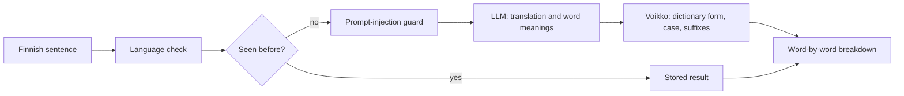

# Finnish Learning Application

A Finnish learning app that explains a sentence instead of only translating it. Paste Finnish text and every word is broken down into its dictionary form, its case and its suffixes, so you can see why the word looks the way it does. Words you want to keep become flashcards, and the app schedules when to review them.

Live: https://padwhen-learningapp.fly.dev/

> When I started learning Finnish, translation tools gave me the meaning of a paragraph but never told me why the words changed form or which rule was at work. I built this to answer that question, and then to help me remember the vocabulary afterwards.

## What it does

### 1. Translate a sentence and see its grammar

https://github.com/user-attachments/assets/87afb58d-aadd-4870-b5e1-279fef2b49b0

- Paste a Finnish sentence or paragraph and get a natural English translation.
- Every word becomes a pill you can open: the meaning in this sentence, the dictionary form, the case or verb form, and the suffix that marks it.
- Each grammar label links to the matching lesson in the grammar course.
- Save one word to a deck, or use **Save all** to keep every word from the sentence. Words are saved in their dictionary form, so `talossa` is stored as `talo`.
- A confidence badge shows how far to trust the translation, with a breakdown and any specific concerns.

### 2. Study with spaced repetition

https://github.com/user-attachments/assets/4d455cf0-7449-4c20-b279-dc6e69838f16

- The review page shows what is due today and a forecast of the days ahead.
- After each card you grade yourself **Again**, **Hard**, **Good** or **Easy**, and the next review date is set from that answer.
- Words move from seed to sprout, sapling and tree as you keep remembering them.
- A pace setting controls the load: 3, 5 or 10 new words a day.

### 3. Read and drill grammar

https://github.com/user-attachments/assets/fc8d3c44-5540-43ab-b0b7-9b9a1ec4955b

- 61 topics from A1 to B2, covering cases, verbs, morphology and syntax.
- Each topic is a short lesson followed by drills: multiple choice, fill in the gap, transform a word, translate, spot the error, complete a table and build a sentence.
- Progress is saved per topic, and topics list what to learn first.

### 4. Pick up decks other learners made

https://github.com/user-attachments/assets/f2d2656a-e83d-46bb-a2af-70378511ff76

- Browse public decks by level and category, preview the words, and save a copy to your own library.
- Publish your own deck, or share it with a private link.

### 5. Practise your own decks

https://github.com/user-attachments/assets/4a8912aa-f809-4f0b-b9ac-fdc45a1d46df

- **Match:** pair each word with its meaning.
- **Type it:** see the meaning and type the Finnish word. Near misses are recognised as close.
- **Cram:** a quick session before a test, with flip, multiple-choice or typing questions in either direction. You choose whether it counts towards your review schedule.
- Decks can be edited, searched and filled by pasting a word list.

## How it works

- **The LLM translates; it does not do the grammar.** Claude produces the translation and the meaning of each word. The grammar comes from [Voikko](https://voikko.puimula.org/), an open-source Finnish morphological analyzer, so cases and verb forms come from rules instead of a model's guess.
- **Repeated sentences are served from a cache**, with no model call.
- **A guard sits in front of the translator.** [avoid-pp](https://github.com/padwhen/avoid-pp) checks whether a passage is text to translate or an instruction aimed at the model. It currently runs in monitoring mode: it records what it flags and the translation still happens.
- **Review dates come from an FSRS-inspired scheduler** that runs on the backend.

## Tech stack

| | |
|---|---|
| Frontend | TypeScript, React, Vite, Tailwind CSS, shadcn/ui |
| Backend | Node.js, Express, MongoDB ([lukea-backend](https://github.com/helppoasuomea/lukea-backend)) |
| Language | Claude API for translation, Voikko for morphology |
| Testing | Vitest and Cypress here, Jest in the backend |
| Delivery | Docker, GitHub Actions, Fly.io |

